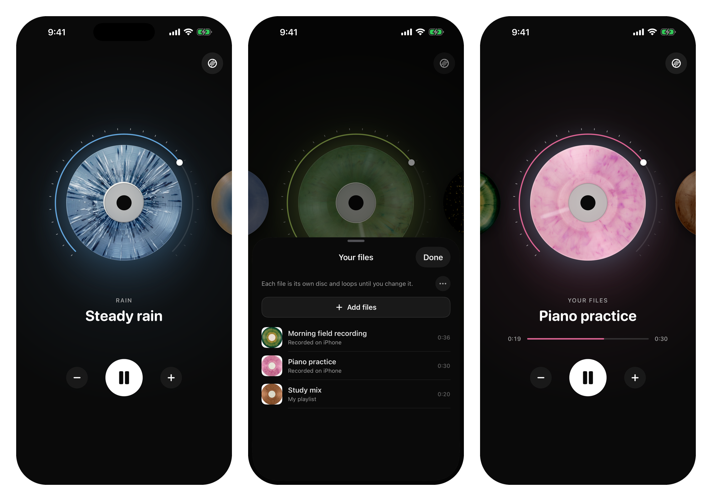

<h1>Duet</h1>

An iPhone audio player that keeps playing under other apps. 
Rain, forest and ocean loops, or your own files, mixed under YouTube, podcasts or anything else.

<strong>Version 1.0</strong> · iOS 17 or later · iPhone

  
  
  

Duet plays audio under whatever else your iPhone is playing. Start a rain loop, then open YouTube, a podcast or Spotify: iOS would normally stop one for the other, but Duet keeps going underneath at its own level. It is for anyone who wants steady background sound, or an audiobook, behind another app.

- Ten recorded loops ship with it, rain, forest and ocean, each on its own disc.
- Files from iCloud or Google Drive become discs too, and remember where you stopped.
- One screen: swipe between discs, tap to play, drag the ring to set the volume.

## How it works

Duet opens its audio session as playback that mixes with others. iOS then lets it run alongside the app in front instead of interrupting it, with the screen off too. The lock screen shows the current disc with play, pause, next and previous.

The disc in the middle is the one playing. Swipe anywhere to move to the next disc, tap it to play or pause, and drag the small knob around the ring to set Duet's level, which is separate from the system volume. Every disc loops until you change it.

The record button at the top right opens Your files. Add files picks audio with the system document picker, and anything you drop into On My iPhone › Duet in the Files app appears there on its own. Duet reads AAC, AIFF, CAF, FLAC, M4A, M4B, MP3 and WAV, including FLAC titles and cover art, which Apple's metadata API skips. Files get a thin scrub line and resume where you left them.

The built-in loops are CC0 field recordings from [Freesound](https://freesound.org), cut into seamless loops; every source is listed in [CREDITS.md](MixLayer/Resources/Sounds/CREDITS.md). The disc art is our own, generated for each sound.

## Privacy

No accounts, no analytics, no network calls. Picked files stay where they are; Duet keeps a bookmark to each one, a small metadata cache, the volume and the resume positions on the device. The full policy is at [santiagoalonso.com/duet/privacy](https://santiagoalonso.com/duet/privacy).

## Limits

One disc plays at a time; there is no layering of two sounds. Portrait iPhone only. The Xcode project, scheme and bundle id still carry Duet's first name, MixLayer.

## Install

Duet 1.0 was submitted to the App Store on October 18, 2026 and is waiting for review; the store link goes here when it is approved. Support is at [santiagoalonso.com/duet/support](https://santiagoalonso.com/duet/support).

To build it yourself you need Xcode 27 and [XcodeGen](https://github.com/yonaskolb/XcodeGen). Run `xcodegen generate`, open `MixLayer.xcodeproj`, and run the MixLayer scheme on a simulator or your iPhone. The source files, device install command, tests, scripts and release lanes are in [docs/how-it-works.md](docs/how-it-works.md).

---

[MIT](LICENSE) for the code and the disc art. The ten loops are CC0 recordings credited in [CREDITS.md](MixLayer/Resources/Sounds/CREDITS.md).

Made by [santiagoalonso.com](https://santiagoalonso.com)
