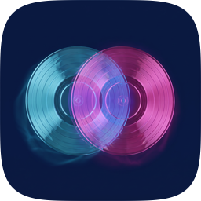

<p></p>

<h1>Duet</h1>

<p>Play local audio quietly under another iPhone app.<br>
Built for music, loops, and audiobooks while YouTube or another audio app keeps playing.</p>

<p><strong>Version 0.1.0</strong> · iOS 17+ · personal device build</p>

<p>
  
  
  
</p>


Duet uses a mixable `AVAudioSession` so its audio keeps playing when another app starts audio — YouTube, Podcasts, Spotify, anything. iOS normally lets these apps interrupt each other; Duet runs under them.

Everything is on one screen: a CD in the middle of a volume dial (drag the ring to set the level), swipe to change discs, and a big play button. Each built-in sound (noise, rain, forest, ocean) is a bare CD; swipe to change it, and the centered disc glows and spins while playing. Your own files live on a separate Your files screen. Your own files (from Files, iCloud, or Google Drive) become a "burned" disc, are remembered across launches, and play as Loop one, Play all, or Shuffle.

Not on TestFlight or the App Store. Personal build signed to a connected iPhone.

## Project Walkthrough

| File | Role |
|---|---|
| `MixLayerApp.swift` | App entry point. Creates `AudioPlayerModel`, boots the library on launch, supports `--autoplay-sample` for QA (plays the first sound). |
| `AudioPlayerModel.swift` | Core model: mixable audio session, built-in sounds, your files with bookmarks, looping, volume, interruptions, lock-screen controls. |
| `PlaybackLogic.swift` | Pure, unit-tested logic: disc order for next/previous, volume stepping, dial geometry, disc spin math. |
| `SoundCatalog.swift` | Built-in sounds and their disc finishes (sheen, case color, glow). |
| `AudioTrack.swift` | `AudioTrack` for a sound or a file; `load()` reads file metadata. |
| `AudioMetadataCache.swift` | On-device metadata cache so reopening the same files is fast. |
| `ContentView.swift` | Main screen (header, volume dial around the disc carousel, transport) and the Your files sheet. |
| `DiscViews.swift` | Disc face, spinning disc, and the carousel disc. |
| `scripts/crop-disc-art.swift` | Crops a generated top-down vinyl photo to a tight square for `Assets.xcassets/DiscArt`. |
| `scripts/generate-disc-art.swift` | Renders the placeholder art printed on each sound's disc (`Assets.xcassets/DiscArt/`). Replace those images to change a disc. |
| `scripts/cut-personal-loops.sh` / `cut-loop.py` | Cuts seamless, level-matched loops from san's downloaded recordings into the git-ignored `MixLayer/PersonalSounds/` (personal builds only). |
| `scripts/generate-noise.py` | Regenerates the seamless noise loops in `MixLayer/Resources/Sounds/`. |
| `project.yml` | XcodeGen source. Re-generate with `xcodegen generate` if changed. |

## Agent Onboarding

If you are starting work on Duet, read these first in order:

1. **`AGENTS.md`** — build/install commands, constraint rules (`.mixWithOthers`, folder mode, etc.)
2. **`plan.md`** — current state, verification commands, known open questions
3. **`backlog.md`** — upcoming work organized by area

## Build

`AGENTS.md` has the exact device-build and install commands. General flow:

```bash
xcodegen generate
xcodebuild -project MixLayer.xcodeproj -scheme MixLayer -destination 'platform=iOS,id=00008150-000A48500132401C' -derivedDataPath build/DerivedData -allowProvisioningUpdates build
xcrun devicectl device install app --device CFC63A02-476D-534D-A1FC-815D2D8EF980 build/DerivedData/Build/Products/Debug-iphoneos/MixLayer.app
```

Clean build if you hit stale caching:

```bash
rm -rf build/DerivedData
```

## Key Constraints

- **Do not remove `.mixWithOthers`** — this is the entire point of the app.
- **Import by picking files only.** Folder import was removed on 2026-10-17.
- **Google Drive support stays as file-picker fallback** unless Drive API integration is explicitly requested.
- **Never commit `build/`** or DerivedData.

Made by [santiagoalonso.com](https://santiagoalonso.com)
